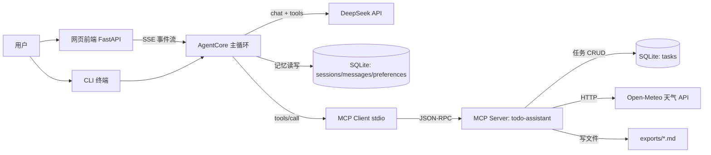
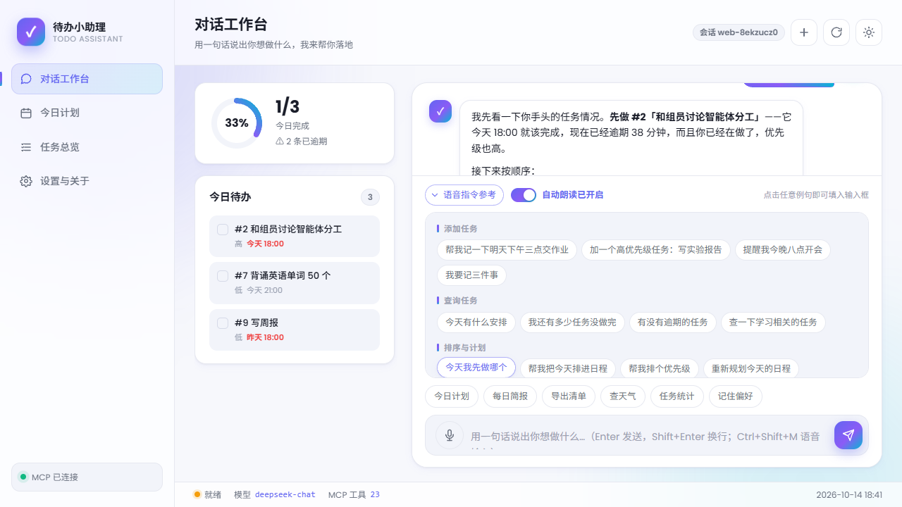

# 待办小助理 · Todo Assistant

> 软件工程第三次作业 —— 一个「能说也会做」的中文任务管理智能体。
> 基于 **MCP（Model Context Protocol）** 构建能力层，用 **DeepSeek** 驱动 Agent 主循环，
> 具备**多轮对话记忆**、**SQLite 数据库交互**、**外部 API 调用**、**网页前端界面**
> 与**语音输入输出**（5 项加分项全部落地）。

---

## 一、这个智能体是什么

用户用日常中文说出需求，它自己决定该调用哪些工具、把结果翻译成人话回给你：

```
你 › 帮我记一下：明天下午3点前交软件工程作业文档，这就是最高优先级；
     顺便今天18点和组员对一下分工
助理 › 好的，我来记一下。
       ⚙ 调用工具 add_tasks({"tasks": [...]})
       ✓ add_tasks 已成功创建 2 条任务：#1「提交软件工程作业文档」、#2「和组员对分工」(48ms)
       ⚙ 调用工具 prioritize_tasks({"limit": 5})
       ✓ prioritize_tasks 最优先是「和组员对分工」（88 分）(5ms)
       已经记好了：
       - **#2 和组员对分工**（今天 18:00，88 分）— 12 小时内到期，建议先做
       - **#1 提交软件工程作业文档**（明天 15:00，82 分）
```

| 环节 | 说明 |
| --- | --- |
| **能说** | 自然语言多轮对话，支持指代消解（"把它改到后天"），会追问缺失信息 |
| **会做** | 23 个 MCP 工具：任务增删改查、优先级打分、日程编排、天气查询、清单导出、提醒、偏好记忆 |
| **有记忆** | 短期窗口（最近 N 轮原文）+ 长期摘要（更早对话压缩入库），跨会话偏好持久化 |
| **有界面** | FastAPI + 原生 HTML/CSS/JS，对话工作台 / 今日计划 / 任务总览 / 设置与关于 |

---

## 二、架构

核心分工是 **「MCP Server 提供能力，Agent 主循环做决策」**：



四层职责清晰、可独立验证：

| 层 | 目录 | 职责 | 能否独立运行 |
| --- | --- | --- | --- |
| 表现层 | `main.py` / `api/` / `web/` | CLI 与网页交互 | ✅ |
| 智能体层 | `agent/` | 模型调用、工具调度、记忆管理 | 需 MCP Server |
| 能力层 | `mcp_server/` | 23 个确定性工具 | ✅ 任何 MCP 客户端可连 |
| 数据层 | `storage/` + `common/` | SQLite、时间解析、配置 | ✅ |

---

## 三、快速开始

### 1. 环境要求

- Python **3.10+**（官方 MCP Python SDK 的最低要求）
- 可访问 `api.deepseek.com` 与 `api.open-meteo.com` 的网络

### 2. 安装

```bash
python -m venv .venv
.venv\Scripts\activate          # Windows；macOS/Linux: source .venv/bin/activate
python -m pip install -U pip
python -m pip install -r requirements.txt
```

### 3. 配置密钥

```bash
copy .env.example .env          # Windows；macOS/Linux: cp .env.example .env
```

编辑 `.env`，填入 DeepSeek 密钥（[申请地址](https://platform.deepseek.com/api_keys)）：

```ini
DEEPSEEK_API_KEY=sk-你的密钥
```

### 4. 三种启动方式

```bash
# ① 终端交互
python main.py

# ② 单次提问（适合脚本化演示与回归验证）
python main.py --once "今天我先做哪个？帮我排个日程"

# ③ 网页界面
python -m api.main
# 浏览器打开 http://127.0.0.1:8000

# ④ 单独运行 MCP Server（可用 MCP Inspector / Claude Desktop 连接验证）
python -m mcp_server.server
```

### 5. 灌入演示数据（可选）

```bash
python scripts/seed_demo_data.py --reset     # 需要先启动 Web 服务
```

会创建 10 条覆盖各种情形的任务（今天/明天/本周/已逾期/无期限、三种优先级、多标签），
让界面与演示脚本开箱即是"有内容"的状态。

### 6. 更多文档

| 文档 | 内容 |
| --- | --- |
| `docs/博客园随笔.md` | 作业随笔：需求描述、业务流、实现说明、使用示例、分工与心得 |
| `docs/使用示例.md` | 端到端验证记录：实测事件流、跨会话偏好验证、异常与边界情况 |
| `scripts/demo_cases.md` | 12 条演示用例（输入 → 预期工具链路 → 预期表现） |
| `scripts/voice_smoke.py` | 语音环境自检：探测引擎 → 合成 → 回喂识别 → 比对相似度 |
| `docs/screenshots/` | 界面截图（四视图 + 深色主题 + 工具调用 + 语音交互） |

---

## 四、语音输入 / 输出（完全离线）

麦克风说话即可下达指令，助理回复可一键朗读或自动播报。整套能力 **不需要任何 API Key**。

### 4.0 两个识别引擎，自动选择

| 引擎 | 精度 | 依赖 | 说明 |
| --- | --- | --- | --- |
| **faster-whisper**（默认优先） | ★★★★☆ | `pip install faster-whisper` + 一次性下载模型 | 本地运行 Whisper 模型，中文识别质量高，长句口语也能准确转写 |
| **Windows SAPI**（自动兜底） | ★★☆☆☆ | 无（系统自带） | 零依赖，未安装上面那个时自动启用；精度明显较低 |

实测同一批测试句（合成音色回环，字面相似度）：

```
SAPI        平均 80.4%     ← 「帮我记一下明天下午三点交作业」被识别成「当我亲一下明天3:00PM交作业」
whisper     平均 93.3%     ← 同一句完全正确；长句 53%→97%、81%→97%、79%→97%
```

> whisper 剩余的差异几乎都是补了句号、把「七点」写成「7点」这类等价问题，
> **语义上 6 句全部正确**；而 SAPI 会把 4 句中有 3 句明显改意。

`.env` 里用 `VOICE_STT_PROVIDER` 控制：`auto`（默认，whisper 优先）/ `whisper` / `sapi`。
答辩现场可以切成 `sapi` 做「基础 vs 高精度」的效果对比。

### 4.1 准备识别模型（一次性）

```bash
python scripts/download_asr_model.py --model small
```

约 480MB，默认走国内镜像（`hf-mirror.com`，因为 `huggingface.co` 在部分网络下不可达），
下载中断会自动断点续传。模型放在 `.data/models/whisper`，不占仓库体积。
若不想下载，直接跳过——系统会自动回退到 SAPI 引擎。

### 4.2 怎么用

| 操作 | 说明 |
| --- | --- |
| 点击输入框左侧的 **麦克风按钮** | 开始录音；说完再点一次结束（上限 15 秒，到点自动结束） |
| `Ctrl + Shift + M` | 快捷键开始 / 结束录音 |
| 录音结束 | **立刻回放一遍你刚说的话**（默认开启），同时并行做识别 → 转成文字填入输入框并发送 |
| 输入区的 **录音后回放** 开关 | 控制录音结束是否自动回放；状态记在浏览器本地 |
| 输入区的 **回放录音** 按钮 | 任何时候再听一遍最近一次录音；回放中显示「回放中…」。**这是判断"识别不准到底是麦克风问题还是引擎问题"最直接的手段** |
| 每条助理回复下方的 **喇叭按钮** | 点击朗读这条回复，再点一次停止 |
| 输入区的 **自动朗读** 开关 | 开启后每次回复自动播报；状态记在浏览器本地 |
| 输入区的 **语音指令参考** | 展开按场景分组的常用说法，点例句即可填入；也是识别引擎的受限语法候选 |
| 设置页 → **语音输入 / 输出** | 查看识别引擎、合成音色、纠错状态，并有「试听合成效果」按钮 |



### 4.3 四条设计原则

1. **完全没有大模型也能用**。语音链路上只有「识别结果纠错」这一步用到 DeepSeek；
   未配置密钥时自动跳过纠错，直接使用原始识别文本，麦克风与朗读照常工作。
2. **准确率靠"选对引擎 + 三重兜底"**：默认走 faster-whisper；未安装时自动回退 SAPI，
   并启用受限指令语法（把常用说法作为候选短语交给引擎）+ 界面上的指令参考；
   只有识别置信度较低（< 0.7）时才调用大模型纠错（带长度守卫，防止改写过度）。
3. **音频转码放在浏览器**。录音得到的是 webm/opus，两个引擎都需要 16kHz 单声道 PCM WAV；
   转换用 Web Audio API 在浏览器内完成，因此**服务端和部署机器都不需要安装 ffmpeg**
   （whisper 侧也只在内存里把 WAV 转成 float32 数组，不落临时文件）。
4. **采集参数面向识别而非通话**。录音时显式关闭 `echoCancellation` 与 `noiseSuppression` ——
   这两个 WebRTC 滤镜是给语音通话用的，谱减法会吃掉清辅音，对识别有害；
   同时打开 `autoGainControl` 把笔记本内置麦的偏低电平拉回正常区间。
   界面上的「回放录音」按钮可以让用户亲耳确认录进去的声音是否正常。

### 4.4 环境自检

```bash
python scripts/voice_smoke.py
```

会依次打印：SAPI 可用的识别引擎与合成音色、Markdown 清洗效果、
**两个识别引擎在同一批测试句上的准确率对比**，最后给出可用性结论
（退出码非 0 表示环境不可用）。加 `--download` 可顺带预下载 whisper 模型。

若两个引擎都不可用，语音入口会自动隐藏并给出文字说明，系统的其他功能完全不受影响。

---

## 五、MCP 工具清单（23 个）

| 分组 | 工具 | 作用 |
| --- | --- | --- |
| **任务** | `add_task` | 新建任务，`due_date` 支持「明天下午3点」「下周一」等中文口语 |
| | `add_tasks` | 批量新建（用户一次说多件事时使用） |
| | `list_tasks` | 按状态/优先级/标签/关键词/截止时间筛选 |
| | `get_task` | 按 ID 查详情 |
| | `task_stats` | 总数、未完成、逾期、今日完成统计 |
| | `update_task` | 局部修改，未传字段保持不变 |
| | `complete_task` / `complete_tasks` | 标记完成（单个 / 批量） |
| | `delete_task` / `delete_tasks` | 删除（**必须先 `confirm=false` 确认**） |
| **规划** | `prioritize_tasks` | 优先级 + 紧急度打分排序，返回打分理由 |
| | `plan_day` | 把任务排入指定日期的可用时段，生成带起止时间的时间轴 |
| | `generate_daily_brief` | 每日简报（天气 + 逾期 + 优先顺序 + 进度） |
| | `export_checklist` | 导出 Markdown/TXT 清单文件并返回绝对路径 |
| **天气** | `get_weather` | Open-Meteo 天气（无需 Key） |
| | `weather_travel_advice` | 聚焦「适不适合出门办事」的结论 |
| **提醒** | `get_due_reminders` | N 小时内到期的未完成任务（含逾期） |
| | `send_desktop_notification` | Windows Toast（可选依赖，缺失自动降级） |
| | `reminder_overview` | 逾期 / 今日到期 / 未来三天 全景 |
| **偏好** | `remember_preference` / `recall_preference` / `list_preferences` / `forget_preference` | 跨会话长期偏好读写 |

优先级打分是可解释的确定性规则（不是黑盒）：

```
排序分 = 优先级权重(高40/中25/低10)
       + 紧急度(逾期45 / 12h内40 / 24h内34 / 2天内28 / 3天内22 / 1周内14 / 无期限8)
       + 进行中加成6
       + 高优且临期组合加成8
       - 超长任务惩罚3(预计超过2小时)
```

日程编排采用**贪心装箱**：按分数从高到低，把任务放入第一个能容纳的空闲时段，
自动跳过午休、预留任务间缓冲；有截止时间的任务必须排在截止之前，排不进则进入
`unscheduled` 并说明原因。

---

## 六、加分项对照

| 加分项 | 实现情况 | 实现位置 |
| --- | --- | --- |
| 多轮对话记忆 | ✅ 短期窗口 + 长期摘要压缩 + 跨会话偏好 | `agent/memory.py`、`storage/repository.py` |
| 与数据库交互 | ✅ SQLite 三张业务表（tasks / sessions+messages / preferences）+ 索引 | `storage/` |
| 与外部 API 交互 | ✅ Open-Meteo 天气（免 Key，含地理编码） | `mcp_server/tools/weather.py` |
| 前端界面 | ✅ FastAPI + 原生 HTML/CSS/JS 四视图，SSE 流式对话与工具调用过程可视化 | `api/`、`web/` |
| 语音输入/输出 | ✅ faster-whisper 高精度引擎 + Windows SAPI 自动兜底，全程离线、零密钥 | `agent/io/whisper.py`、`agent/io/sapi.py`、`agent/voice_service.py`、`web/voice.js` |

---

## 七、目录结构

```
homework3/
├── main.py                      # CLI 入口（rich 交互式 REPL）
├── common/                      # 通用基础能力
│   ├── config.py                #   集中式配置（.env → 强类型 Settings）
│   └── timeutil.py              #   中文口语时间解析与格式化
├── storage/                     # 数据层
│   ├── db.py                    #   SQLite 连接、建表、索引、事务
│   └── repository.py            #   任务 / 会话 / 偏好仓储
├── mcp_server/                  # 能力层（MCP Server）
│   ├── server.py                #   FastMCP 实例与 stdio 启动入口
│   └── tools/                   #   23 个工具，分 5 组
│       ├── base.py              #   统一返回格式 + 异常兜底装饰器
│       ├── tasks.py planner.py weather.py reminders.py prefs.py
├── agent/                       # 智能体层
│   ├── core.py                  #   主循环：对话→决策→执行→回填
│   ├── llm.py                   #   DeepSeek 流式客户端 + 工具调用增量聚合
│   ├── mcp_client.py            #   MCP stdio 客户端（actor 模式）
│   ├── memory.py                #   短期窗口 + 长期摘要
│   ├── prompts.py               #   系统提示词
│   ├── voice_service.py         #   语音编排：纠错守卫、清洗、合成缓存
│   └── io/                      #   语音接口层
│       ├── voice.py             #     SpeechToText / TextToSpeech 协议与工厂
│       ├── wavutil.py           #     WAV 解析 / 格式校验 / 电平分析（两引擎共用）
│       ├── whisper.py           #     faster-whisper 高精度引擎
│       ├── sapi.py              #     Windows SAPI 桥接（常驻 worker + JSON 行协议）
│       └── voice_worker.ps1     #     PowerShell worker（UTF-8 BOM，勿丢）
├── api/                         # Web 层
│   ├── main.py schemas.py       #   FastAPI 应用与请求响应模型
│   └── voice.py                 #   /api/voice 路由（status/hints/transcribe/speak）
├── web/                         # 前端
│   ├── index.html app.js style.css
│   └── voice.js                 #   录音、16k WAV 转换、喇叭播放、指令面板
├── scripts/                     # demo_cases.md / voice_smoke.py / seed_demo_data.py
├── docs/                        # 博客园随笔与使用示例
└── exports/                     # 清单导出目录（运行时生成）
```

---

## 八、常见问题

**Q：启动报「未检测到 DEEPSEEK_API_KEY」？**
把 `.env.example` 复制为 `.env` 并填入密钥；`.env` 已被 `.gitignore` 排除，不会提交。

**Q：数据库文件在哪？**
默认 `.data/todo.db`，可用 `TODO_DB_PATH` 指定。删除该文件即可重置全部数据。

**Q：MCP Server 能单独跑吗？**
可以。`python -m mcp_server.server` 是标准 stdio MCP Server，不依赖大模型，
可直接用 MCP Inspector 或 Claude Desktop 连接，工具可被任何 MCP 客户端复用。

**Q：为什么工具调用结果不让模型直接贴给用户？**
工具返回的是结构化 JSON，系统提示词要求模型翻译成人话，避免用户看到原始 JSON。

**Q：为什么日志不能 `print`？**
MCP 的 stdout 是 JSON-RPC 协议通道，任何 `print` 都会污染协议流导致客户端解析失败。
本项目所有日志统一走 stderr。语音 worker 同理，stdout 只用于返回 JSON 行。

**Q：界面加了新功能，但我这里点了没反应？**
先按 `Ctrl + Shift + R` 强制刷新一次。项目已给静态资源加了
`Cache-Control: no-cache, must-revalidate`，并让 `index.html` 里的
`app.js` / `voice.js` / `style.css` 自动带上内容版本号（`?v=<hash>`），
正常刷新即可拿到新文件；强刷只是把历史遗留的旧缓存一次性清掉。

**Q：语音按钮不出现 / 显示"语音输入不可用"？**
先跑 `python scripts/voice_smoke.py`。若两个引擎都不可用，说明既没装 faster-whisper，
系统也没有中文语音引擎（英文版 Windows 默认没有中文识别组件）。

**Q：识别不准怎么办？**
① 先确认当前用的是哪个引擎 —— 设置页「语音输入 / 输出」卡片会显示
「高精度 · 本地模型 small」还是「基础 · Windows 自带引擎」；
② 若显示"基础"，说明 faster-whisper 没生效：`python -m pip install faster-whisper`
然后 `python scripts/download_asr_model.py --model small`；
③ 顺带看一眼识别后输入框上方的「录音峰值 xx dBFS」，低于 −30dBFS 说明是麦克风音量问题，
可点「回放录音」亲耳确认；
④ 若已用高精度引擎仍不准，试试 `VOICE_WHISPER_MODEL=medium`（更准更慢）。

**Q：模型下载很慢 / 老是断？**
默认已指向国内镜像 `hf-mirror.com`。下载脚本自带**断点续传重试**（默认 8 次），
中断后重新执行即可从断点继续。想换源：`VOICE_WHISPER_ENDPOINT=` 留空用官方源，
或改成其他镜像。

**Q：识别一次要多久？**
实测 `small` 模型在 CPU int8 上约 **0.4~0.5 倍实时**：4 秒语音约 1.6~1.9 秒出结果。
服务启动时会后台预热模型，避免第一次说话多等十几秒。

**Q：`voice_worker.ps1` 里的中文为什么要求 UTF-8 with BOM？**
PowerShell 5.1 读取 `.ps1` 时若无 BOM，会按系统 ANSI 代码页（简体中文环境即 GBK）解析源码，
脚本里的中文字面量会变成乱码并直接导致语法错误。程序启动时会自动检查并补写 BOM。
