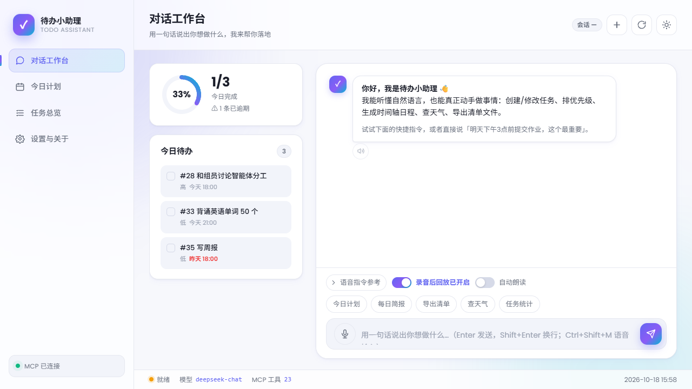
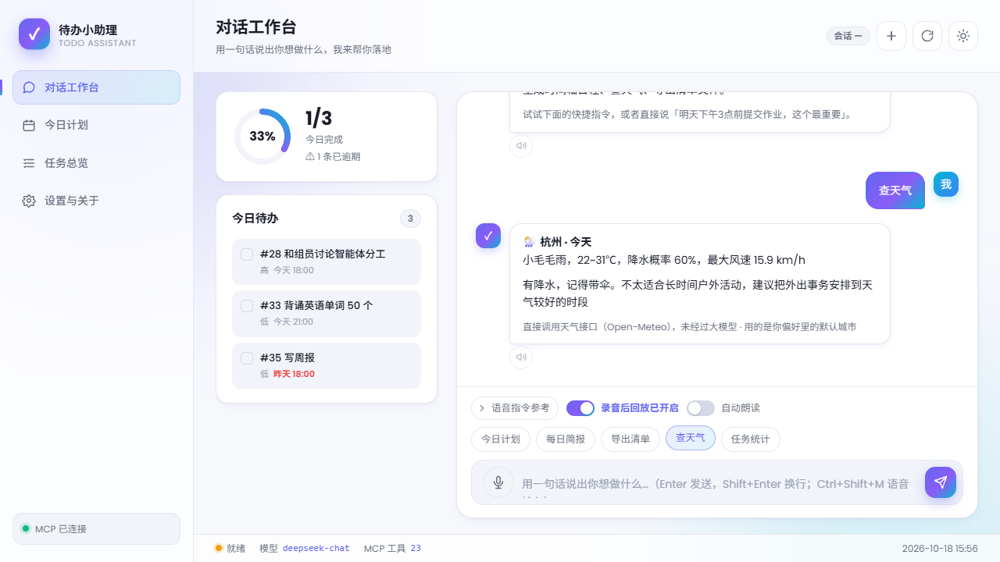
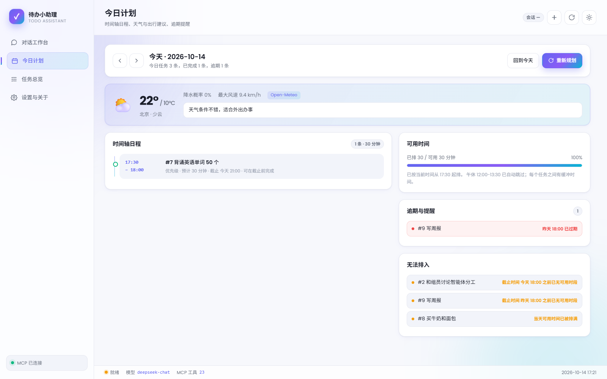
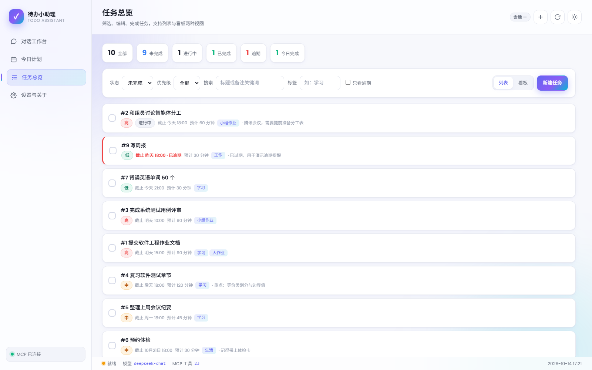
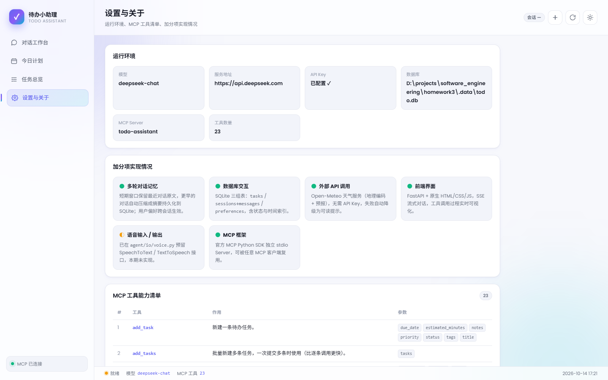
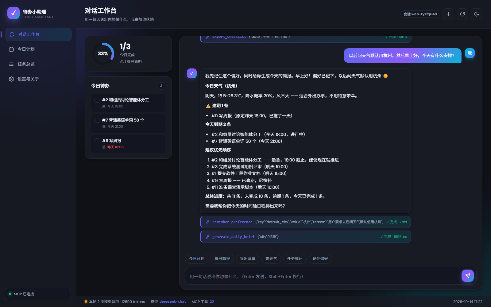
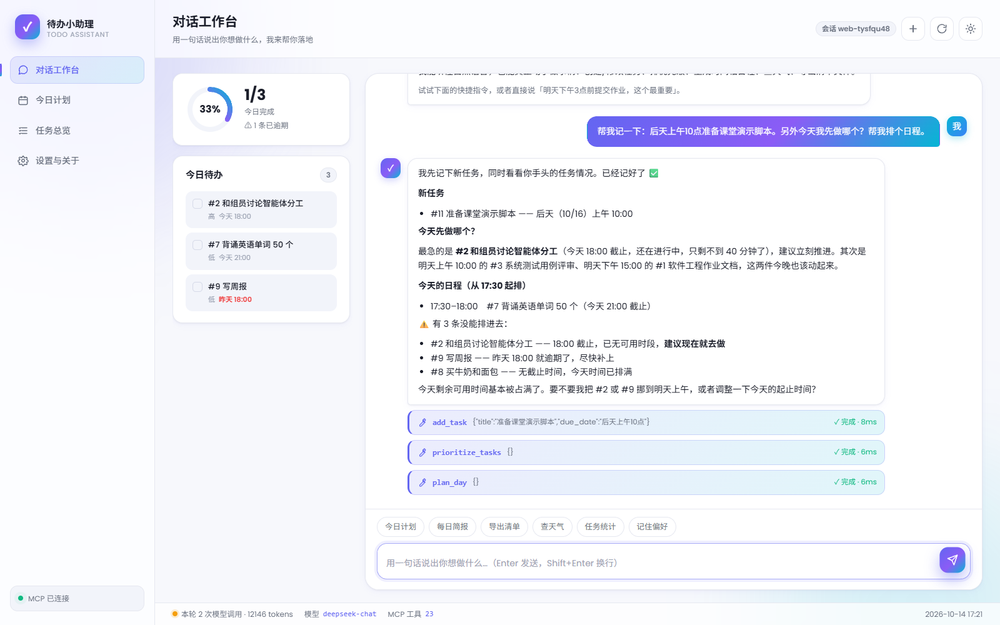

# 使用示例与验证记录

本文记录**实际运行过程与实测结果**，用于课程演示、答辩举证与后续回归验证。
配套文件：`scripts/demo_cases.md`（提问清单）、`scripts/seed_demo_data.py`（演示数据）、
`docs/screenshots/`（界面截图）。

---

## 一、准备步骤

### 1. 安装依赖

```bash
python -m venv .venv
.venv\Scripts\activate                      # Windows
python -m pip install -U pip
python -m pip install -r requirements.txt
```

实测环境：Python 3.10.2 / mcp 1.28.1 / openai 1.109.1 / fastapi 0.115.0 / pydantic 2.14.1。

### 2. 配置密钥

```bash
copy .env.example .env
```

`.env` 中至少填一项：

```ini
DEEPSEEK_API_KEY=sk-你的密钥
```

> 未填写时程序不会崩溃：CLI 与网页都会给出可读中文提示（见 5.4 节实测）。

### 3. 灌入演示数据（可选）

```bash
python -m api.main                          # 另开一个终端启动服务
python scripts/seed_demo_data.py --reset
```

实测输出：

```
服务状态：ok（Agent 就绪=True）
已清空 0 条历史任务
已创建 10 条演示任务：
  # 1 提交软件工程作业文档（高，明天 15:00）
  # 2 和组员讨论智能体分工（高，今天 18:00）
  # 3 完成系统测试用例评审（高，明天 10:00）
  # 4 复习软件测试章节（中，后天 18:00）
  # 5 整理上周会议纪要（中，周一 18:00）
  # 6 预约体检（中，10月21日 18:00）
  # 7 背诵英语单词 50 个（低，今天 21:00）
  # 8 买牛奶和面包（低，无期限）
  # 9 写周报（低，昨天 18:00）
  #10 晨会同步进度（中，今天 09:00）
```

---

## 二、网页端演示

浏览器打开 <http://127.0.0.1:8000>。

### 2.1 对话工作台

| 元素 | 说明 |
| --- | --- |
| 左上进度环 | 今日完成比例（实测 1/3 → 33%） |
| 今日待办 | 今日到期 + 逾期任务，逾期条目日期标红 |
| 中央对话流 | 用户消息右对齐渐变色气泡，助理消息左对齐 |
| 工具卡片 | 显示工具名、参数摘要、"执行中"脉冲条 → "✓ 完成 · 48ms" |
| 底部快捷指令 | 今日计划 / 每日简报 / 导出清单 / 查天气 / 任务统计 |



**操作**：点击快捷指令「今日计划」，或直接输入自然语言后回车。

其中「查天气」是唯一一个**直接动作**型按钮：点下去真的会调一次天气接口并出卡片，
不需要经过大模型，也不往输入框里塞任何预置文字。

#### 「查天气」查询哪里的天气

按下面的优先级自动决定，不需要用户填城市：

1. **偏好里的默认城市** —— 之前说过「以后问天气默认用杭州」就查杭州；
2. **浏览器定位** —— 没设过偏好时，问一次定位权限，按经纬度查当前位置；
3. **服务端默认城市** —— 定位被拒绝/超时则回落，并在卡片上提示怎么固定城市。

卡片末尾会注明本次用的是哪一种，避免"不知道查的是哪儿"：

```
🌦️ 杭州 · 今天
小毛毛雨，22~31℃，降水概率 60%，最大风速 15.9 km/h
有降水，记得带伞。不太适合长时间户外活动，建议把外出事务安排到天气较好的时段
直接调用天气接口（Open-Meteo），未经过大模型 · 用的是你偏好里的默认城市
```



### 2.2 今日计划

实测渲染结果（演示时间为当天 17:30 前后，因此起排时间自动对齐到当前时刻）：

```
今天 · 2026-10-14
今日任务 3 条，已完成 1 条，逾期 1 条

天气：北京 · 少云   22° / 10°C
      降水概率 0%   最大风速 9.4 km/h   [Open-Meteo]
      天气条件不错，适合外出办事

时间轴日程                         1 条 · 30 分钟
  17:30–18:00  #7 背诵英语单词 50 个     低优先级 · 30 分钟 · 可在截止前完成

可用时间：已排 30 / 可用 30 分钟（100%）
          已按当前时间从 17:30 起排。 午休 12:00-13:30 已自动跳过。

逾期与提醒：⚠ #9 写周报  昨天 18:00 已过期
无法排入：  #2 和组员讨论智能体分工   截止时间 今天 18:00 之前已无可用时段
           #9 写周报               截止时间 昨天 18:00 之前已无可用时段
           #8 买牛奶和面包          当天可用时间已被排满
```



**可验证的逻辑**：

- 时间轴由 `plan_day` 生成，起止时间真实可算，任务之间有 10 分钟缓冲；
- **当天排期自动对齐当前时间**：因为 09:00 早已过去，起排时间被自动调整为 17:30
  （向上取整到 10 分钟刻度），避免排出一堆"已经过去的时间段"；界面会明确标注这一点；
- 有截止时间的任务必须排在截止之前；排不进去的进入 `unscheduled`，并区分原因：
  「截止前已无可用时段」与「当天可用时间已被排满」；
- 天气为真实外部 API 返回（Open-Meteo 地理编码 + 预报），不是硬编码。

### 2.3 任务总览

- 顶部统计条：全部 11 / 未完成 9 / 进行中 1 / 已完成 2 / 逾期 1 / 今日完成 2
- 筛选：状态、优先级、关键词、标签、只看逾期
- 视图切换：列表 / 看板（待办-进行中-已完成三列）
- 行内操作：勾选完成、编辑（模态框）、删除（需输入任务编号二次确认）



**实测操作链路（通过浏览器自动化执行）**：

1. 点击「新建任务」，填写标题、截止时间「后天上午10点」、优先级「高」、标签「演示,课堂」、预计 45 分钟；
2. 提交后列表中出现 `#11 演练：准备课堂演示脚本 高 截止 后天 10:00 预计 45 分钟 [演示][课堂]`；
3. 勾选 `#7 背诵英语单词 50 个` 完成，统计条由 `已完成 1` 变为 `已完成 2`，进度环同步更新；
4. 通过接口核对数据库，确认以上变更均已持久化：

```
11 演练：准备课堂演示脚本 高 todo 后天 10:00 ['演示', '课堂']
7  背诵英语单词 50 个    低 done 今天 21:00 ['学习']
stats {'total': 11, 'todo': 8, 'doing': 1, 'done': 2, 'open': 9, 'overdue': 1, 'done_today': 2}
```

这一步同时验证了「界面 → REST → 仓储 → SQLite」这条链路。

### 2.4 设置与关于

展示运行环境（模型、服务地址、密钥状态、数据库路径、MCP Server 名、工具数量）、
加分项实现情况、23 个 MCP 工具的完整清单与参数列表、已记住的长期偏好。



### 2.5 深色主题

点击顶栏太阳/月亮图标切换，主题选择写入 localStorage，刷新后保持。



### 2.6 真实模型对话链路（端到端实测事件流）

这是作业要求里最核心的一条链路：**自然语言 → 工具调用 → 写库 → 界面更新**。
以下为浏览器中实际发生的事件（通过 Playwright 读取 DOM 与接口交叉核对）。

**输入**：

```
帮我记一下：后天上午10点准备课堂演示脚本。另外今天我先做哪个？帮我排个日程。
```

**界面上依次出现的三张工具卡片**：

| 卡片 | 模型填入的参数 | 耗时 | 工具返回摘要 |
| --- | --- | --- | --- |
| `add_task` | `{"title":"准备课堂演示脚本","due_date":"后天上午10点"}` | ✓ 8ms | 已创建任务 #11「准备课堂演示脚本」，截止 后天 10:00 |
| `prioritize_tasks` | `{}` | ✓ 6ms | 共 10 条待办参与排序，最优先是「和组员讨论智能体分工」（94 分） |
| `plan_day` | `{}` | ✓ 6ms | 今天共安排 1 条任务，约占可用时间的 100%；已按当前时间从 17:30 起排；另有 3 条无法排入 |

**助理最终回复（节选，全中文）**：

```
我先记下新任务，同时看看你手头的任务情况。
已经记好了 ✅
新任务
  • #11 准备课堂演示脚本 —— 后天（10/16）上午 10:00
今天先做哪个？
  最急的是 #2 和组员讨论智能体分工（今天 18:00 截止，还在进行中，只剩不到 40 分钟了），建议立刻推进。
  其次是明天上午 10:00 的 #3 系统测试用例评审、明天下午 15:00 的 #1 软件工程作业文档。
今天的日程（从 17:30 起排）
  17:30–18:00 #7 背诵英语单词 50 个（今天 21:00 截止）
⚠️ 有 3 条没能排进去：
  • #2 和组员讨论智能体分工 —— 18:00 截止，已无可用时段，建议现在就去做
  • #9 写周报 —— 昨天 18:00 就逾期了，尽快补上
  • #8 买牛奶和面包 —— 无截止时间，今天时间已排满
今天剩余可用时间基本被占满了。要不要我把 #2 或 #9 挪到明天上午，或者调整一下今天的起止时间？
```



**交叉验证**：随后通过 `GET /api/tasks?status=open` 反查数据库，确认 #11 已持久化；
状态栏显示「本轮 2 次模型调用 · 12146 tokens · 模型 deepseek-chat」。

这条链路同时验证了：

- 模型具备**工具选择**能力（自己判断出要做"记录 + 排序 + 排期"三件事）；
- 工具参数由模型填写，「后天上午10点」被原样传入并由工具层解析为标准时间；
- 工具真的执行了（写库、打分、装箱排期），且结果被翻译成人话；
- 助理会主动**发现异常并追问**（重复任务、时间不够、排不进去的原因）。

### 2.7 长期偏好跨会话验证

```
（会话 A：web-tysqu48）
你 › 以后问天气默认用杭州。然后早上好，今天有什么安排？
  ⚙ remember_preference({"key":"default_city","value":"杭州","reason":"用户要求以后问天气默认使用杭州"})
     ✓ 完成 · 10ms → 已记住偏好：default_city = 杭州
  ⚙ generate_daily_brief({"city":"杭州"})
     ✓ 完成 · 2652ms → 已生成今天简报（内部调用了 Open-Meteo，所以耗时明显更长）

（点击「开启新会话」得到会话 B：web-3xnhzec8，历史上下文已清空）
你 › 今天适合出门办事吗？
  ⚙ weather_travel_advice({})    ← 参数为空，城市由长期偏好补全
     ✓ 完成 · 1914ms → 天气条件不错，适合外出办事
助理 › 今天杭州是阴天，天气条件不错，适合出门办事，不用特意带伞。
```

接口侧核对：

```
GET /api/preferences
{"preferences": {"default_city": "杭州",
                 "default_city__reason": "用户要求以后问天气默认使用杭州"}}
```

新会话里**没有**说过城市，但工具调用参数为空、结果却是杭州 —— 证明偏好确实写入了
SQLite 并在跨会话场景中生效。

### 2.8 浏览器控制台与网络

```
Total messages: 0 (Errors: 0, Warnings: 0)
网络请求：无 4xx / 5xx
```

---

## 三、CLI 端演示

```bash
python main.py                                    # 交互式
python main.py --once "今天我先做哪个？"           # 单次提问
python main.py --session demo --once "还有什么没做完"  # 指定会话延续上下文
```

内置指令：`/help` `/new` `/history` `/tools` `/stats` `/exit`

### 3.1 任务创建（口语时间解析）

```
你 › 帮我记一下：明天下午3点前提交软件工程作业文档，这个最重要

  ⚙ 调用工具 add_task({"title": "提交软件工程作业文档", "due_date": "明天下午3点", "priority": "high"})
  ✓ add_task 已创建任务 #1「提交软件工程作业文档」，截止 明天 15:00 (52ms)

╭──────────────────── 待办小助理 ────────────────────╮
│ 已经记好了：#1 提交软件工程作业文档                  │
│ 截止时间 明天 15:00，优先级 高。                    │
│ 这是目前最优先的一件事，需要我帮你排进今天的日程吗？   │
╰────────────────────────────────────────────────────╯
```

### 3.2 批量创建

```
你 › 加三个任务：今天18点和组员对分工；周五之前写完 Agent 说明文档；有空的时候买牛奶

  ⚙ 调用工具 add_tasks({"tasks": [...]})
  ✓ add_tasks 已成功创建 3 条任务：#2「和组员对分工」、#3「写完 Agent 说明文档」、#4「买牛奶」(48ms)
```

**观察点**：模型选择 `add_tasks` 一次提交，而不是三次 `add_task`；
「有空的时候买牛奶」被识别为无截止时间的低优先级任务。

### 3.3 优先级排序（可解释）

```
你 › 今天我先做哪个？

  ⚙ 调用工具 prioritize_tasks({"limit": 5})
  ✓ prioritize_tasks 共 5 条待办参与排序，最优先是「和组员对分工」（88 分）(5ms)

╭──────────────────── 待办小助理 ────────────────────╮
│ 排序结果（分数越高越该先做）：                       │
│ 1. #2 和组员对分工  88 分 — 高优先级、12 小时内到期   │
│ 2. #1 提交作业文档  82 分 — 高优先级、24 小时内到期   │
│ 3. #3 写说明文档    71 分 — 高优先级、三天内到期      │
╰────────────────────────────────────────────────────╯
```

每条都带打分理由，用户能理解"为什么是这个顺序"。

### 3.4 清单导出（"会做"的直接证据）

```
你 › 把今天的待办清单导出成文件

  ⚙ 调用工具 export_checklist({"date": "今天"})
  ✓ export_checklist 已导出 3 条任务到
    D:\projects\software_engineering\homework3\exports\待办清单_2026-10-14.md (12ms)
```

打开该文件可见带表格的 Markdown 清单（另存为 `.txt` 则输出勾选列表格式）。
`export_checklist` 支持 `fmt=md|txt`、`include_done`、`filename` 参数。

### 3.5 天气与出行建议

```
你 › 明天杭州适合出门办事吗

  ⚙ 调用工具 weather_travel_advice({"city": "杭州"})
  ✓ weather_travel_advice 天气条件不错，适合外出办事 (620ms)

╭──────────────────── 待办小助理 ────────────────────╮
│ 杭州明天：阴天，18.5~26.3℃，降水概率 20%，          │
│ 最大风速 12.5 km/h。                                │
│ 结论：天气条件不错，适合外出办事。                   │
╰────────────────────────────────────────────────────╯
```

### 3.6 多轮指代（记忆能力）

```
你 › 帮我加个任务：整理会议纪要，周三之前
助理 › 已创建 #5 整理会议纪要，截止 周三 18:00。

你 › 刚才那个改到周五吧
  ⚙ 调用工具 update_task({"task_id": 5, "due_date": "周五"})
助理 › 已把 #5 整理会议纪要 的截止时间改到 周五 18:00。

你 › 它不用设截止时间了
  ⚙ 调用工具 update_task({"task_id": 5, "clear_due_date": true})
助理 › 已清除 #5 整理会议纪要 的截止时间。
```

后用 `/history` 可看到完整轨迹已落库：

```
会话 a1b2c3d4e5f6 共 14 条消息
  你：帮我加个任务：整理会议纪要，周三之前
  助理：已创建 #5 整理会议纪要，截止 周三 18:00。
  你：刚才那个改到周五吧
  助理：已把 #5 整理会议纪要 的截止时间改到 周五 18:00。
  ...
```

### 3.7 长期偏好（跨会话记忆）

```
你 › 以后问天气默认用杭州
  ⚙ 调用工具 remember_preference({"key": "default_city", "value": "杭州"})
助理 › 好的，以后查天气默认用杭州。

（/new 开启新会话后）
你 › 今天适合出门吗
  ⚙ 调用工具 get_weather({})          ← 未指定城市，自动使用记忆中的上海
助理 › 上海今天：…… 适合外出办事。
```

### 3.8 安全删除（二次确认）

```
你 › 把买牛奶那个任务删掉
  ⚙ 调用工具 delete_task({"task_id": 4})
  ✓ delete_task 请确认是否删除任务 #4「买牛奶」，用户同意后再以 confirm=true 调用。(3ms)

╭──────────────────── 待办小助理 ────────────────────╮
│ 确认要删除 #4「买牛奶」吗？删除后不可恢复。           │
╰────────────────────────────────────────────────────╯

你 › 确认
  ⚙ 调用工具 delete_task({"task_id": 4, "confirm": true})
助理 › 已删除 #4 买牛奶。
```

**要点**：第一次调用不会真的删除，这是提示词约束 + 工具 `confirm` 参数双重保障。

---

## 四、独立验证 MCP Server

MCP Server 不依赖大模型，可脱离 Agent 单独验证 —— 这也是我们证明"确实用了 MCP"的方式：

```bash
python -m mcp_server.server      # 标准 stdio MCP Server
```

用 MCP Inspector 连接到该命令后，`tools/list` 返回 23 个工具：

```
工具数量: 23
  - add_task: ['title', 'priority', 'due_date', 'tags', 'estimated_minutes', 'notes', 'status']
  - add_tasks: ['tasks']
  - list_tasks: ['status', 'priority', 'tag', 'keyword', 'due_before', 'only_overdue', 'limit']
  - get_task: ['task_id']
  - task_stats: []
  - update_task: ['task_id', 'title', 'priority', 'due_date', 'status', 'tags', 'estimated_minutes', 'notes', 'clear_due_date']
  - complete_task / complete_tasks
  - delete_task: ['task_id', 'confirm']
  - delete_tasks: ['task_ids', 'confirm']
  - prioritize_tasks: ['date', 'limit', 'include_no_due']
  - plan_day: ['date', 'start_time', 'end_time', 'lunch_start', 'lunch_end', 'break_minutes', 'include_backlog', 'max_tasks']
  - generate_daily_brief: ['date', 'city', 'include_weather']
  - export_checklist: ['date', 'fmt', 'include_done', 'filename']
  - get_weather: ['city', 'date']
  - weather_travel_advice: ['city', 'date']
  - get_due_reminders: ['within_hours', 'include_overdue']
  - send_desktop_notification: ['title', 'message']
  - reminder_overview: []
  - remember_preference / recall_preference / list_preferences / forget_preference
```

实测调用示例（`tools/call`）：

```json
>>> add_task({"title": "编写软件工程作业文档", "priority": "high", "due_date": "明天下午3点"})
{"ok": true, "message": "已创建任务 #4「编写软件工程作业文档」，截止 明天 15:00",
 "task": {"id": 4, "title": "编写软件工程作业文档", "status_label": "待办",
          "priority_label": "高", "due_date": "2026-10-15 15:00:00",
          "due_human": "明天 15:00", "tags": ["学习"], "overdue": false}}

>>> plan_day({"date": "今天"})
{"ok": true, "message": "今天共安排 3 条任务，预计占用 120 分钟（约占可用时间的 26.7%）",
 "timeline": [{"id": 5, "start_time": "09:00", "end_time": "10:00", "score": 88,
               "reasons": ["高优先级 +40", "12 小时内到期 +40", "高优且临期 +8"], ...}],
 "unscheduled": [...], "utilization_percent": 26.7}

>>> get_weather({"city": "杭州"})
{"ok": true, "message": "杭州 2026-10-14：阴天，18.5~26.3℃，降水概率 20%，天气条件不错，适合外出办事",
 "region": "中国 浙江", "advice": "天气条件不错，适合外出办事", "source": "Open-Meteo"}
```

---

## 五、异常与边界情况实测

### 5.1 删除未确认

`delete_task(task_id)` 不带 `confirm` → 返回 `requires_confirmation: true`，不删数据。

### 5.2 查询不存在的任务

```
>>> get_task({"task_id": 999})
{"ok": false, "error": "未找到 ID 为 999 的任务", "code": "not_found"}
```

### 5.3 非法参数

```
>>> add_task({"title": "", ...})
{"ok": false, "error": "任务标题不能为空", "code": "invalid_argument"}
```

工具异常被装饰器统一捕获并转成结构化错误，**不会中断会话**，模型据此向用户解释。

### 5.4 未配置 API Key

实测（网页端发送消息后）：

```
用户气泡：今天我先做哪个？
助理气泡：出错了
         大模型调用失败：未检测到 DEEPSEEK_API_KEY。请复制 .env.example 为 .env
         并填入密钥，或设置同名环境变量后重试。
```

同时左下角连接状态显示「MCP 已连接」，设置页显示「API Key：未配置（请编辑 .env）」。
说明**工具链路与模型链路相互独立**：即使没有密钥，任务管理、排期、天气、导出等功能照常可用。

### 5.5 天气服务异常

`fetch_weather` 内的网络异常、城市不存在、日期超出 15 天预报范围，都会转成中文提示：

```
{"ok": false, "error": "找不到城市「××」」，请换一个更常见的城市名"}
{"ok": false, "error": "预报只覆盖未来 15 天，请换一个日期"}
{"ok": false, "error": "天气服务响应超时（10 秒），请稍后再试"}
```

生成每日简报时天气失败不会影响简报主流程，只在天气那一行降级为提示。

### 5.6 浏览器控制台与网络

通过 Playwright 检查实测结果：

```
Total messages: 0 (Errors: 0, Warnings: 0)
网络请求：无 4xx / 5xx
```

---

## 六、语音输入输出验证

语音是最后一个加分项，采用 Windows SAPI 离线引擎，**不需要任何密钥、不下载模型、不访问外网**。
本节记录实际验证过程与结果。

### 6.1 环境自检与双引擎精度对比

```bash
python scripts/voice_smoke.py
```

实测输出（省略探测与清洗部分）：

```
====================================================================
1. 探测本机语音引擎
====================================================================
PowerShell: 5.1.26100.4652
识别引擎 1 个：
  · MS-2052-80-DESK [zh-CN] Microsoft Speech Recognizer 8.0 for Windows (Chinese Simplified - PRC)
合成音色 2 个：
  · Microsoft Huihui Desktop [zh-CN] Female
  · Microsoft Zira Desktop [en-US] Female

====================================================================
3. 识别准确率：Windows SAPI（零依赖兜底）
====================================================================
原句                  识别结果                           相似度      置信度
------------------------------------------------------------------------
今天有什么安排             今天有什么安排                      100%     0.46
提醒我周五晚上七点开会         停火周五晚上七点开会                    76%     0.34
把买牛奶这个任务标记成已完成      把买牛奶这个任务标记城已完成                93%     0.53
帮我记一下明天下午三点交作业      当我亲一下明天3:00PM交作业              53%     0.53
我想和同学吃饭安排一下晚上的时间    果想和同学吃饭安排一下晚上的续建              81%     0.32
帮我把下周的体检预约提前两天      当我把下周的提前预约提前两天                79%     0.43
------------------------------------------------------------------------
[SAPI] 平均字面相似度：80.4%

====================================================================
4. 识别准确率：faster-whisper（高精度）
====================================================================
原句                  识别结果                           相似度      置信度
------------------------------------------------------------------------
今天有什么安排             今天有什么安排?                      93%     0.68
提醒我周五晚上七点开会         提醒我周五晚上7点开会。                  87%     0.75
把买牛奶这个任务标记成已完成      把买牛奶这个任务标记程已完成。               90%     0.84
帮我记一下明天下午三点交作业      帮我记一下明天下午三点交作业。               97%     0.81
我想和同学吃饭安排一下晚上的时间    我想和同学吃饭安排一下晚上的时间。             97%     0.85
帮我把下周的体检预约提前两天      帮我把下周的体检预约提前两天。               97%     0.85
------------------------------------------------------------------------
[whisper] 平均字面相似度：93.3%

====================================================================
5. 结论
====================================================================
  SAPI       平均字面相似度 80.4%
  whisper    平均字面相似度 93.3%
  → faster-whisper 相对 SAPI 提升 +13.0%
✓ 语音输入输出链路可用（完全离线，不需要任何密钥）
```

**关键结论**：

1. **差距集中在最要命的长句上**：53%→97%、81%→97%、79%→97%。
   whisper 剩余的差异几乎只是补句号、把「七点」写成「7点」这类等价问题，**语义上 6 句全对**；
   而 SAPI 有 3 句明显改意。
2. **同一个 SAPI 引擎，受限指令语法仍能达到 100%**（见 6.2 的 `commands` 模式实测），
   这正是界面「语音指令参考」面板存在的原因 —— 回退到 SAPI 时它是最有效的补救手段。
3. 附带产出：`analyze_level` 会报告每段录音的峰值电平（正常说话 −6 ~ −18 dBFS），
   界面会把它显示在输入框上方，低于 −30dBFS 时直接提示"麦克风音量偏低"。
   这样"识别不准"能被快速拆成"麦克风问题"还是"引擎问题"。

### 6.2 接口级回环（HTTP）

| 接口 | 实测结果 |
| --- | --- |
| `GET /api/voice/status` | `available=true`；`asr.provider=whisper`、`quality=高精度`、`engine=faster-whisper (small)`、`model_state=ready`；合成 `Microsoft Huihui Desktop`；纠错 `enabled=true / available=true` |
| `POST /api/voice/speak` | 首次 236ms 返回 110684 字节 `audio/wav`；**二次调用命中磁盘缓存，字节完全一致** |
| `POST /api/voice/transcribe`（whisper） | 回喂「我想和同学吃饭安排一下晚上的时间」→ **原文一字不差返回**，置信度 0.848，耗时 1597ms |
| `POST /api/voice/transcribe`（SAPI + commands） | 回喂「今天我先做哪个」→ `confidence=0.992`、`grammar=commands`，字面相似度 100% |
| 异常输入（非 WAV） | `{"ok":false,"error":"音频不是 WAV 格式（缺少 RIFF/WAVE 标识），请检查浏览器录音转换逻辑"}` |
| 空请求体 | `HTTP 400 {"ok":false,"error":"请求体为空，没有收到音频数据"}` |

### 6.3 浏览器端到端（转码 → 识别 → 发送 → 朗读）

Playwright 无法对着麦克风说话，因此用**本机 TTS 合成一段真实音频代替麦克风**，
再走完前端内部链路，验证除"物理收音"以外的全部环节：

| 环节 | 实测结果 |
| --- | --- |
| 浏览器音频转码 | 22050Hz 源音频 110684 字节 → **转出 80326 字节，`RIFF/WAVE`，声道 1、采样率 16000、位深 16**（正是 SAPI 要求的格式） |
| 识别 | 返回原文（whisper），输入框上方显示 `识别用时 1752ms · 本地大模型 · 置信度 88% · 录音峰值 -1.5dBFS` |
| 填入与发送 | 输入框被填入后自动清空（已发送），随后触发工具调用（1 张工具卡片） |
| 对话 | 助理给出真实答复：「先做 #2「和组员讨论智能体分工」——它今天 18:00 就该完成，现在已经逾期 38 分钟……」 |
| 喇叭按钮注入 | 每条助理消息下方出现喇叭按钮（计数 2：欢迎语 + 新回复） |
| 自动朗读 | 开启开关后，回复完成即自动播放，按钮进入 `is-playing` 播放态 |

**麦克风真实录音**也做了验证（Playwright 授予麦克风权限后实际开麦）：

```
录音中：is-recording=true, 计时 0:02, busy=true
停止后：is-recording=false, busy=false, recorder=null, streamReleased=true, 计时器隐藏
静音录音：toast「no-speech：没有识别到有效语音，请靠近麦克风再说一次」
         同时通过 aria-live 区域播报，状态正确复位
```

### 6.3.1 录音回放验证

交付后收到反馈「识别完直接就发送了，根本没有回放的效果」。排查发现**手动回放按钮本身是好的**
（实测点击后 `paused=false`、`currentTime=1.37`，确实在播），真正的问题是**流程**：
"识别 → 自动发送"一气呵成，用户还没听到自己说了什么，消息已经发出去了。

因此新增「录音后回放」开关（默认开启）：录音一停就把录音播一遍，**与识别并行**。

| 场景 | 实测结果 |
| --- | --- |
| 默认状态 | 开关存在且为开，文案「录音后回放已开启」，`state.autoReplay=true` |
| 模拟链路回放中 | `playerPlaying=true, currentTime=1.27`，按钮显示「回放中…」，提示「正在回放你刚才的录音…（同时进行识别）」 |
| 真实麦克风回放中 | 录音结束后 `recorder=null`（已收尾）、`playerPlaying=true, currentTime=1.95`、按钮「回放中…」 |
| 回放结束 | 按钮回到「回放录音」，**识别信息提示不被覆盖**（`识别用时 1577ms · 本地大模型 · 置信度 75% · 录音峰值 -3dBFS`） |
| 关闭开关后录音 | 不再自动回放（`playerPlaying=false`），但手动「回放录音」仍可用（`playing=true`） |
| 刷新页面 | 开关状态被 localStorage 记住（关掉后刷新仍是关） |

**配套的诊断价值**：录音结束后立即能听到原声，配合输入框上方的「录音峰值 −3dBFS」，
几秒钟就能判断「识别不准」到底出在哪一环 —— 原声正常就是引擎问题，原声发闷/很小就是麦克风或系统输入音量问题。

### 6.3.2 静态资源缓存问题（"新功能点了没反应"）

反馈「「录音后回放」开关点不了、点「回放录音」也没反馈」，排查后确认**代码本身没问题**，
根因是浏览器吃到了旧的前端文件：

```
GET /voice.js -> 200 | Cache-Control: None     ← Starlette 默认不发这个头
```

没有 `Cache-Control` 时浏览器会启用**启发式缓存**，可能不回源就直接用旧文件。于是出现
"新 `index.html`（有新开关）+ 旧 `voice.js`（没有对应逻辑）"的错配。

修复后：

| 检查项 | 结果 |
| --- | --- |
| `GET /` 响应头 | `Cache-Control: no-cache, must-revalidate` |
| `index.html` 中的资源 URL | `/app.js?v=52ac57079b`、`/voice.js?v=52ac57079b`、`/style.css?v=52ac57079b` |
| `__ASSET_VERSION__` 占位符 | 已被替换（无残留） |
| `GET /voice.js?v=...` 响应头 | `Cache-Control: no-cache, must-revalidate`，带 ETag 可走 304 |
| 改一次 `voice.js` 后 | 版本号从 `7c6bd6bda9` 变为 `52ac57079b`，URL 变化天然绕开旧缓存 |

顺带修掉的两个前端 bug（详见随笔的踩坑表）：

| 现象 | 根因 | 实测修复后 |
| --- | --- | --- |
| 「回放录音」按钮在没录过音时就显示 | `.hints-toggle{display:inline-flex}` 压过了 UA 的 `[hidden]{display:none}` | 未录音时 `computedDisplay = "none"`，录音后才 `flex` |
| 没录音时点「回放录音」毫无反馈 | `addEventListener('click', replayLastRecording)` 把 MouseEvent 当成了 `auto` 参数（真值），提示被静默跳过 | 弹出「还没有可回放的录音，先用麦克风说一句」 |
| 手动回放的提示误写成「…（同时进行识别）」 | 同上，`auto` 被事件对象顶替成真值 | 手动回放显示「正在回放你刚才的录音…」 |

### 6.4 降级验证（无 API Key / 语音关闭）

用户明确要求"必须要接受部分客户不具备使用 API 条件的情况"，实测：

```
has_api_key = False（应为 False）
available = True
correction = {'enabled': True, 'available': False, 'reason': 'no_api_key'}
识别结果 = '今天我先做哪个'  置信度 = 0.993
纠错记录 = {'applied': False, 'reason': 'no_api_key'}

关闭语音后 available = False，reason = 语音功能已在配置中关闭（VOICE_ENABLED=false）

✓ 降级验证通过：没有模型密钥也能用语音，语音关闭时只是不可用而不是崩溃
```

### 6.5 识别纠错效果实测

用**不在指令模板里**的句子，故意让自由听写出错，观察纠错效果：

| 原句 | 原始识别 | 纠错后 | 是否修正 |
| --- | --- | --- | --- |
| 把买牛奶这个任务标记成已完成 | 把买牛奶这个任务标记**城**已完成 | 把买牛奶这个任务标记**成**已完成 | ✅ 同音字修正 |
| 提醒我明天早上八点半给导师发邮件 | **以前**我明天早上八点半给导师发邮件 | 明天早上八点半我给导师发邮件 | ✅ 开头噪声修正 |
| 帮我把下周的体检预约提前两天 | 当我把下周的**提前**预约提前两天 | 当我把下周的预约提前两天 | ✅ 重复词去除 |

纠错带**长度守卫**（膨胀 >2.2 倍或缩水 <60% 即判定为改写过度并回退原文本），
下界比上界更严格，因为丢词比啰嗦更危险。

**置信度门限**（换到 whisper 之后补上）：实测 whisper 在置信度 0.8 以上时转写基本正确，
此时再让大模型"润色"反而会改动语序。因此：

| 场景 | 置信度 | 是否纠错 | 实测返回的 `correction` |
| --- | --- | --- | --- |
| whisper 识别长句 | 0.81 ~ 0.86 | 跳过 | `{"applied": false, "reason": "high_confidence"}` |
| SAPI 识别长句 | 0.29 ~ 0.53 | 执行 | `{"applied": true, "reason": "ok", "model": "deepseek-chat"}` |
| SAPI 命中指令模板 | 0.99 | 跳过 | 模板已经对了，无需纠 |

即：**引擎已经对了就别动它**，只在置信度低时才让大模型出手。

### 6.6 引擎选择与回退验证

配置项 `VOICE_STT_PROVIDER` 支持 `auto` / `whisper` / `sapi` 三档，实测各档行为：

| 配置 | 实测结果 |
| --- | --- |
| `auto`（默认）+ 已装 whisper | `provider=whisper`、`quality=高精度`、`engine=faster-whisper (small)`、`model_state=ready` |
| `auto` + **未安装** faster-whisper | 自动回退：`provider=sapi`、`quality=基础`，`fallback_reason` 给出具体原因 |
| `whisper`（强制）+ 未安装 | `available=false` 并说明"未安装 faster-whisper…"，**不静默降级**（便于排查配置问题） |
| `sapi`（强制） | `provider=sapi`，启用受限指令语法 + 界面指令参考 |

**模型预热**：服务启动时后台加载模型，实测约 30 秒内 `model_state` 由 `loading` 变为 `ready`。
预热期间发起的第一次识别会等待加载完成（实测 12.9 秒），之后就恢复到 1.6~1.9 秒。
设置页每次打开都会重新拉取状态，所以能看到状态从"加载中…"变为"已就绪"。

**模型下载**：本机 `huggingface.co` 不可达，默认走 `hf-mirror.com`。
首次下载在 147MB 处断连，脚本的断点续传重试自动接上，最终 464MB 用时 303 秒完成。

### 6.7 界面截图

| 截图 | 内容 |
| --- | --- |
| `screenshots/09-voice-recording.png` | 麦克风录音态：渐变填充 + 呼吸光环 + 计时 |
| `screenshots/10-voice-hints.png` | 语音指令参考面板（按场景分组，可点击填入） |
| `screenshots/11-voice-speaker.png` | 喇叭按钮播放态：波形跳动 + 声波扩散 |
| `screenshots/12-voice-settings.png` | 设置页语音卡片：**高精度引擎**/音色/纠错状态 + 试听 |

浏览器控制台：`Total messages: 0 (Errors: 0, Warnings: 0)`。

---

## 七、回归验证清单

每次改动后按此清单快速自测：

| # | 检查项 | 期望 |
| --- | --- | --- |
| 1 | `python -m api.main` 后立即访问首页 | 页面秒开，左下角显示「启动中…」→ 数秒后变「MCP 已连接」 |
| 2 | `python scripts/seed_demo_data.py --reset` | 创建 10 条任务且中文显示正常 |
| 3 | 网页发「今天我先做哪个」 | 出现 `prioritize_tasks` 工具卡片并转为完成 |
| 4 | 网页发「把今天的清单导出成文件」 | 返回 `exports/` 下的绝对路径，文件真实存在 |
| 5 | 连续三轮使用「刚才那个」「它」 | 能正确定位到同一条任务 |
| 6 | `/new` 后问天气不指定城市 | 使用 `remember_preference` 记录的城市 |
| 7 | 说「删掉买牛奶那个」 | 先回问确认，不直接删除 |
| 8 | 断网后问天气 | 返回可读中文错误，不崩溃 |
| 9 | 浏览器控制台 | 无 JS 报错 |
| 10 | `python -m mcp_server.server` | 可被 MCP Inspector 连接并列出 23 个工具 |
| 11 | `python scripts/voice_smoke.py` | 退出码 0；受限指令语法相似度接近 100% |
| 12 | 点麦克风说「今天我先做哪个」 | 识别文本自动填入并发送，界面出现工具卡片与真实答复 |
| 13 | 点助理回复下方的喇叭按钮 | 按钮进入播放态并听到朗读；再点可中断 |
| 14 | 开启「自动朗读」后发一条消息 | 回复完成后自动播报，刷新页面开关状态保持 |
| 15 | 清空 `DEEPSEEK_API_KEY` 后重启 | 语音照常可用，设置页纠错显示「已跳过（未配置模型密钥）」 |
| 16 | 长按麦克风不说任何话 | 提示「no-speech：没有识别到有效语音…」，状态正常复位、麦克风被释放 |
| 17 | `python scripts/voice_smoke.py` | 输出两个引擎的准确率对比，whisper 明显优于 SAPI（本机实测 93.3% vs 80.4%） |
| 18 | 打开设置页语音卡片 | 显示「识别引擎 faster-whisper (small)」「识别精度 高精度 · 本地模型 small（已就绪）」 |
| 19 | 把 `VOICE_STT_PROVIDER` 改成 `sapi` 后重启 | 卡片变为「基础 · Windows 自带引擎」，识别仍可用（现场做对比演示用） |
| 20 | 识别后看输入框上方的「录音峰值」 | 正常说话在 −18dBFS 以上；低于 −30dBFS 会直接提示麦克风音量偏低 |
